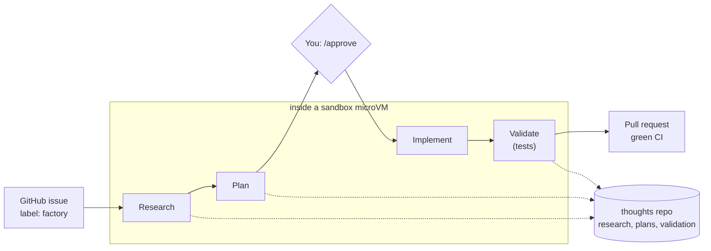
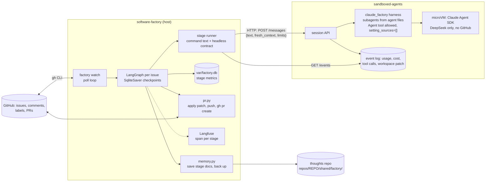
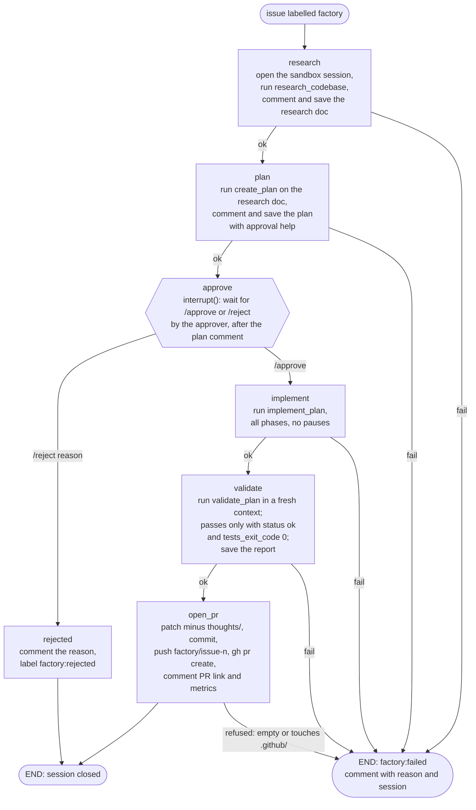
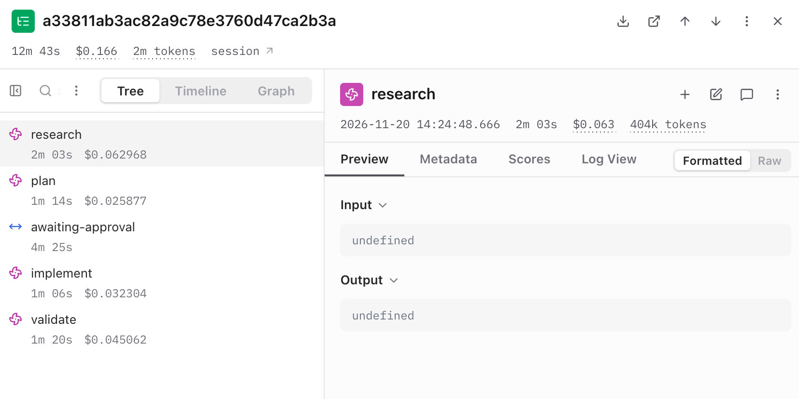

# software-factory: a personal multi-agent software factory

**TL;DR:** you write a GitHub issue, approve the plan an agent proposes, and get back a pull request with green CI. Everything in between (research, planning, coding, testing) runs on its own, inside a throwaway VM, and every step is measured. On the demo repo it closed 4 of 4 issues at about $0.16 and 6 minutes each.

## What it is for

Small, well-specified work that you would rather review than do: a bug with a clear repro, a missing flag, an edge case that crashes, a chore. Instead of opening your editor, you label the issue `factory`. About four minutes later there is a plan to approve on the issue, and a few minutes after your `/approve` there is a PR to review. Big or fuzzy features still go better interactively; the factory is for the backlog of small things.

## In plain terms

**The problem.** A coding agent on your laptop is fast, but you have to sit with it, it can touch anything on your machine, and you have no idea afterwards what it cost or why it went wrong.

**How the factory solves it.**

- **It works like a careful engineer, in three steps: Research, Plan, Implement (RPI).** First it reads the code the issue touches and writes down how it works today. Then it writes a plan from that research. Only after a human approves the plan does it write code, and then a separate step checks the result against the plan and runs the tests. Splitting the work this way is what keeps a cheap model on track: each step starts with a clean head and a document from the step before.
- **It works in a sandbox.** Each issue gets its own microVM with a copy of the repo. The agent can run anything in there, but it has no GitHub access and no keys, and nothing leaves the VM except one patch file. If it goes wrong, you throw the VM away.
- **It lives in GitHub.** No new UI: the issue is the ticket, the research and plan arrive as comments, your approval is a comment, the result is a pull request, and labels show where each issue is.
- **It remembers.** Every research, plan and validation report is saved to a [HumanLayer thoughts](https://github.com/humanlayer/humanlayer/blob/77c7fe99/hlyr/THOUGHTS.md) repository, under `repos/<repo>/shared/factory/`, and committed and pushed after each run. Over time that folder becomes the repo's memory: what was investigated, what was decided and why, and what passed validation, one document per issue and stage.
- **It measures everything.** Cost, tokens, tool calls and time per step land in SQLite, in a Langfuse trace, and in the PR description.



The stages run my own Claude Code commands (`research_codebase`, `create_plan`, `implement_plan`, `validate_plan`) headless, on DeepSeek, inside a microVM from [sandboxed-agents](https://github.com/morri5/sandboxed-agents). Results on the demo repo [factory-playground](https://github.com/morri5/factory-playground): 4 of 4 issues reached a pull request with green CI, at a median of $0.1578 and 6 min 26 s of factory time per issue (see [Runs](#runs)).

## Architecture



The host orchestrates and the VM works. One sandbox session holds the issue's VM and working tree from research to validate; every stage is one message with `fresh_context`, so each stage agent starts with a clean context on the tree the previous stage left. The stage documents (research, plan, validation report) and the code change leave the VM in one place: the session's saved workspace patch. The host reads the documents from it, posts them on the issue, saves them to the thoughts repo, and turns the code part into the PR. The VM never holds a GitHub credential. The reasons behind this split are in [docs/design-notes.md](docs/design-notes.md).

## The graph

One LangGraph thread per issue (`thread_id = issue-<n>`), checkpointed in `var/checkpoints.db` ([src/factory/graph.py](src/factory/graph.py)).



- **Stage nodes** (`research`, `plan`, `implement`, `validate`) send the command file's body, prefixed with a headless contract, as one message to the session API. They parse the `FACTORY_RESULT` line at the end of the agent's answer, read the stage document out of the workspace patch, record the run in SQLite and Langfuse, and report on the issue. A failed run, a missing or invalid `FACTORY_RESULT` line, an agent that reports `fail`, or a missing document sends the graph to `END` with `factory:failed` and a comment naming the reason and the sandbox session.
- **`approve`** calls `interrupt()` and has no side effects, since it re-runs on resume. `factory watch` polls the issue's comments; when the approver answers, it resumes the thread with `Command(resume=decision)`. The checkpoint keeps the thread across restarts and days of waiting, and a resume never re-runs research or plan.
- **Memory.** Each stage saves its document to `<thoughts>/repos/<repo>/shared/factory/{research,plans,validation}/` as soon as it is read, even when the stage fails, so a failed validation report is kept too. When the issue's invocation ends, however it ends, `memory.backup` commits that folder alone as `factory` and pushes it. Other changes in the thoughts repo stay untouched, and the repo's git hooks are skipped so a sync hook cannot sweep them in. A failed push only logs a warning; the commit goes out with the next push or sync.
- **`open_pr`** refuses an empty diff (nothing was implemented) and one that touches `.github/` (workflow changes need a human). Any unexpected error in any node (the session API gone, a push refused) is caught by the CLI, which labels the issue `factory:failed`, comments the error and closes the session.

## Labels

`factory` queues an issue. The factory then keeps exactly one status label on it:

| Label | Meaning |
| --- | --- |
| `factory:research` | Picked up; research and plan are running |
| `factory:awaiting-approval` | The plan is posted; waiting for `/approve` or `/reject <reason>` |
| `factory:implement` | Approved; implement and validate are running |
| `factory:pr-open` | The PR is open, with the metrics table on the issue |
| `factory:merged` | The PR was merged (checked on every `watch` tick) |
| `factory:failed` | A stage failed; the comment names the reason and the sandbox session |
| `factory:rejected` | The plan was rejected; the comment echoes the reason |

`factory watch` creates any of these labels the repository lacks when it starts. To run an issue again, remove its status label: the run starts over at research and needs a new `/approve`.

## Setup

Requirements: [uv](https://docs.astral.sh/uv/), Docker (for Langfuse), the `gh` CLI logged in with the `repo` scope, and a checkout of `sandboxed-agents` next to this repo with its own requirements (microsandbox, `DEEPSEEK_API_KEY`).

You also need your own Claude Code command files (`research_codebase.md`, `create_plan.md`, `implement_plan.md`, `validate_plan.md`) and the agent files they spawn; this repo does not ship them (see [Limitations](#limitations)).

1. Start the session API in the sandbox lab, with the subagent definitions it should load:

   ```
   echo 'FACTORY_AGENTS_DIR=~/.claude/agents' >> ../sandboxed-agents/.env
   make -C ../sandboxed-agents api
   ```

   Only the agent files (as subagent definitions) and the command files (as message text) cross into the VM. Your `CLAUDE.md` and settings never do: the model provider would receive them.

2. Configure and install the factory, and start Langfuse (optional: without it tracing is skipped with a warning):

   ```
   cp .env.example .env    # FACTORY_REPO, FACTORY_APPROVER, FACTORY_COMMANDS_DIR, ...
   uv sync
   make langfuse-up        # UI on http://localhost:3100, login admin@factory.local
   ```

## Quick start

```
make -C ../sandboxed-agents api    # in one terminal (with FACTORY_AGENTS_DIR, see above)
make watch                             # in another
```

Then label an issue `factory`, wait for the plan comment, and answer it with `/approve`. `make run ISSUE=<n>` runs one issue in the foreground instead, up to the approval. `make report` writes [docs/runs.md](docs/runs.md) from `var/factory.db`, and `uv run python -m factory.tracing --check issue-<n>` checks that the issue's current run has one generation per stage with tokens and cost in Langfuse.

## Configuration

| Variable | Default | Meaning |
| --- | --- | --- |
| `LAB_API_URL` | `http://127.0.0.1:8000` | The sandbox lab's session API |
| `FACTORY_REPO` | `morri5/factory-playground` | The target repository (public: the model provider sees its code) |
| `FACTORY_APPROVER` | `morri5` | The only GitHub login whose `/approve` or `/reject` counts |
| `FACTORY_COMMANDS_DIR` | `~/.claude/commands` | Where `research_codebase.md` and the other command files live |
| `FACTORY_THOUGHTS_DIR` | `~/GitHub/thoughts` | The thoughts repository where stage documents are saved and pushed |
| `FACTORY_POLL_S` | `60` | Seconds between two `watch` ticks |
| `FACTORY_VAR_DIR` | `var` | Where `factory.db` and `checkpoints.db` live |
| `FACTORY_<STAGE>_MAX_TOOL_CALLS`, `_RUN_TIMEOUT_S`, `_MAX_USD` | see `src/factory/config.py` | Per-stage run limits, sent with each stage's message |
| `LANGFUSE_HOST`, `LANGFUSE_PUBLIC_KEY`, `LANGFUSE_SECRET_KEY` | `http://localhost:3100`, `pk-lf-factory`, `sk-lf-factory` | The local Langfuse from `compose.yaml`, whose headless init creates these keys |

## Runs

The four prepared issues of `factory-playground`, from [docs/runs.md](docs/runs.md) (generated by `make report`; each issue's current run, factory time excludes the approval wait):

| Issue | Outcome | PR | Cost | Tool calls (by subagents) | Factory time | Approval wait |
| --- | --- | --- | ---: | ---: | ---: | ---: |
| #1 Monthly totals ignore refunds | merged | [#6](https://github.com/morri5/factory-playground/pull/6) | $0.1308 | 165 (97) | 7 min 22 s | 7 min 53 s |
| #2 Add a --category filter to summary | merged | [#7](https://github.com/morri5/factory-playground/pull/7) | $0.1517 | 195 (119) | 5 min 27 s | 9 min 16 s |
| #3 CSV export misses the header row | merged | [#5](https://github.com/morri5/factory-playground/pull/5) | $0.1639 | 223 (142) | 5 min 31 s | 45 s |
| #4 CLI crashes on an empty file | merged | [#8](https://github.com/morri5/factory-playground/pull/8) | $0.1662 | 203 (125) | 8 min 33 s | 4 min 25 s |

- Success rate (PR opened or merged): 4 of 4 (100%)
- Median cost per issue: $0.1578
- Median factory time: 6 min 26 s

Subagents make about 60% of all tool calls. Research is the most expensive stage on every issue. What went wrong on the way there, and what changed because of it, is in the [design notes](docs/design-notes.md#lessons-from-the-runs).

Each issue run is one trace in Langfuse, with one generation per stage (usage, cost, tool calls, the commands and agents hashes) and a span for the approval wait:



## Limitations

- **Runs on DeepSeek through an unofficial path.** The Claude Agent SDK talks to DeepSeek's Anthropic-compatible endpoint. It works for every run here, but neither vendor officially supports the combination, so an update on either side can break it. One symptom already: the SDK's usage figures leave out the subagents, so the runner reads them from the CLI's transcripts.
- **The commands and agents are not included.** The stages run my own versions of the `research_codebase`, `create_plan`, `implement_plan` and `validate_plan` commands and the subagents they spawn. They started from the ones HumanLayer published in [humanlayer/humanlayer at `77c7fe99`](https://github.com/humanlayer/humanlayer/tree/77c7fe99/.claude/commands) (Apache 2.0) and have since been modified for my own use, and they stay private. To run the factory, point `FACTORY_COMMANDS_DIR` and `FACTORY_AGENTS_DIR` at your own command and agent files with those names.
- **Public repositories only.** The model provider receives the code.
- **Stdlib-only target.** The VM can reach the model provider and nothing else, so it cannot install packages; validate can only run tests that need nothing beyond the standard library.
- **No revision loop.** `/reject <reason>` ends the run; a failed validate ends it too. Re-running an issue starts over at research.
- **One issue at a time**, found by polling (no webhooks), and no auto-merge: a human reviews and merges every PR.
- **The agent's own model calls are not in Langfuse.** They happen inside the VM; each stage is one generation with its totals.

## Development

```
make lint test check-names
```

## License

Apache-2.0
