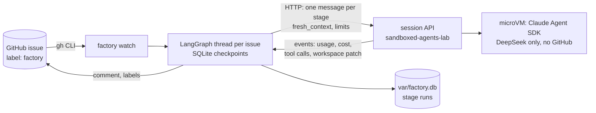

# multi-agent-lab: a personal software factory

A GitHub issue labelled `factory` goes through one agent per stage: research, plan, one human approval, implement, validate, and a pull request. Each stage agent runs one of my own Claude Code commands (`research_codebase`, `create_plan`, `implement_plan`, `validate_plan`) headless, inside a microVM from [sandboxed-agents-lab](https://github.com/morri5/sandboxed-agents-lab). Every stage run is measured: tokens, cost, tool calls (also those of subagents), turns and wall time.

Work in progress. Today the factory runs the research stage: it picks up a labelled issue, researches the code it touches, posts the research document as an issue comment and records the run's metrics.



## Setup

Requirements: [uv](https://docs.astral.sh/uv/), the `gh` CLI logged in with the `repo` scope, and a checkout of `sandboxed-agents-lab` next to this repo with its own requirements (Docker, microsandbox, `DEEPSEEK_API_KEY`).

1. Start the session API in the sandbox lab, with the subagent definitions it should load:

   ```
   LAB_FACTORY_AGENTS_DIR=~/.claude/agents make -C ../sandboxed-agents-lab api
   ```

   Only the agent files (as subagent definitions) and the command files (as message text) cross into the VM. Your `CLAUDE.md` and settings never do: the model provider would receive them.

2. Configure and install the factory:

   ```
   cp .env.example .env    # FACTORY_REPO, FACTORY_COMMANDS_DIR, ...
   uv sync
   ```

3. Run it:

   ```
   make run ISSUE=1        # one issue in the foreground
   make watch              # every open issue labelled `factory`, one at a time
   ```

## Configuration

| Variable | Default | Meaning |
| --- | --- | --- |
| `LAB_API_URL` | `http://127.0.0.1:8000` | The sandbox lab's session API |
| `FACTORY_REPO` | `morri5/factory-playground` | The target repository (public: the model provider sees its code) |
| `FACTORY_APPROVER` | `morri5` | The only GitHub login whose approval counts |
| `FACTORY_COMMANDS_DIR` | `~/.claude/commands` | Where `research_codebase.md` and the other command files live |
| `FACTORY_POLL_S` | `60` | Seconds between two looks at the issue queue |
| `FACTORY_<STAGE>_MAX_TOOL_CALLS`, `_RUN_TIMEOUT_S`, `_MAX_USD` | see `src/factory/config.py` | Per-stage run limits |

## Labels

`factory` queues an issue. The factory then sets one status label: `factory:research` while and after the research stage, `factory:failed` when a stage fails (with a comment naming the reason and the sandbox session).

## Development

```
make lint test check-names
```

## License

Apache-2.0
